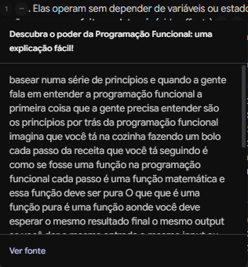

# 🧠 Segundo Cérebro: Programação Funcional

Repositório desenvolvido para o **módulo de Onboarding + IA para Acelerar o Desenvolvimento** do curso de **Python para Análise e Automação de Dados** da plataforma **DIO**. O projeto documenta o processo de estudos, curadoria de fontes e interação com uma inteligência artificial especialista no paradigma de **Programação Funcional**, construído através do Gemini Notebook.

## 🎯 Tema e Objetivo
> **"Construir um segundo cérebro especializado em Programação Funcional para compreender conceitos avançados, imutabilidade, funções puras e aplicação prática em diferentes linguagens, servindo como base de estudos centralizada e confiável."**

---

## 📚 Fontes Confiáveis Utilizadas
As fontes abaixo foram para alimentar o Gemini Notebook:

1. **Programação Funcional // Dicionário do Programador** *https://youtu.be/BxbHGPivjdc?si=Lx-Tn_7gzijUeqaq*
2. **Descubra o poder da Programação Funcional: uma explicação fácil!** *https://youtu.be/7mVVIayE7A8?si=qH9qqspWXIhczpzA*
3. **O que é programação funcional? Aprenda em 3 Minutos!** *https://youtu.be/yktYimHJGj8?si=tByOUxj4P00QPtgu*
4. **Programação funcional: O que é?** *https://www.alura.com.br/artigos/programacao-funcional-o-que-e*
5. **Programação Funcional: o que é, principais conceitos e vantagens!** *https://blog.betrybe.com/tecnologia/programacao-funcional/*

---

## ⚙️ Diretriz de Comportamento (System Prompt)
A seguinte diretriz foi fornecida ao Gemini Notebook para moldar a postura do especialista:

> *"Comporte-se como um especialista sênior em Programação Funcional e ciência da computação teórica. Responda com precisão técnica, utilize analogias claras quando necessário, priorize os conceitos de imutabilidade, funções de alta ordem e transparência referencial, e baseie suas respostas estritamente nas fontes fornecidas neste caderno."*

---

## 💬 Interações com o Cérebro (Perguntas e Respostas)

Abaixo esta um exemplo de consulta realizada ao modelo e as evidências de validação por citação:

### Pergunta 1: *"Qual é a principal diferença entre funções puras e impuras, e por que a imutabilidade é importante na programação funcional?"*
* **Resposta do Notebook:** A diferença entre uma função pura e impura, está na sua saída e no seu impacto externo. Já em relação a imutabilidade, sua importância se dá na Previsibilidade e Ausência de Efeitos Colaterais e na Facilidade para Testes e Manutenção, e entre outros.   
* **Link das Fontes Citadas:**
1. *https://youtu.be/7mVVIayE7A8?si=qH9qqspWXIhczpzA*
2. *https://youtu.be/yktYimHJGj8?si=tByOUxj4P00QPtgu*
3. *https://www.alura.com.br/artigos/programacao-funcional-o-que-e*
4. *https://youtu.be/BxbHGPivjdc?si=Lx-Tn_7gzijUeqaq*  
* **Evidência:** **

---

## 🔗 Link do Notebook Compartilhado
*https://notebook.google.com/notebook/cf78f99b-a582-4ca4-99e0-f1c1b1912f83/preview* 

---

## 📁 Materiais Gerados e Evidências
Os seguintes materiais extraídos do Estúdio do Gemini Notebook estão disponíveis neste repositório:
* 🗺️ **Mapa Mental:** `materiais/mapa-mental-funcional.png`
* 📊 **Apresentação de Slides:** `materiais/slides-programacao-funcional.pdf`
* 🎧 **Guia de Estudos:** `materiais/guia-estudos-funcional.pdf`
